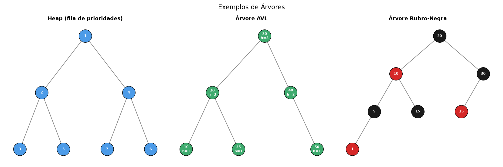

#  Árvores Binárias em Python

Implementações didáticas de três estruturas de dados em árvore, com visualização gráfica:

- **Fila de Prioridades** (Heap, uma árvore binária quase completa)
- **Árvore AVL** (balanceamento por altura)
- **Árvore Rubro-Negra** (balanceamento por cores)



---

##  Sumário

1. [Por que balancear uma árvore?](#-por-que-balancear-uma-árvore)
2. [Fila de Prioridades (Heap)](#1--fila-de-prioridades--heap)
3. [Árvore AVL](#2--árvore-avl)
4. [Árvore Rubro-Negra](#3--árvore-rubro-negra)
5. [Comparativo](#-comparativo)
6. [Como executar](#-como-executar)
7. [Estrutura do projeto](#-estrutura-do-projeto)

---

##  Por que balancear uma árvore?

Uma árvore binária de busca (BST) comum guarda os menores valores à esquerda e os maiores à direita. Buscar, inserir e remover custam **O(altura)**.

O problema é que a altura depende da ordem de inserção. Inserindo `10, 20, 30, 40, 50` em ordem crescente, a árvore degenera em uma lista:

```
10
  \
   20
     \
      30
        \
         40
           \
            50      altura = 5 → busca O(n)
```

As árvores **AVL** e **Rubro-Negra** corrigem isso sozinhas a cada inserção ou remoção, garantindo altura **O(log n)**. Com 1 milhão de elementos, o pior caso fica em torno de 20 comparações, em vez de 1 milhão.

---

## 1.  Fila de Prioridades — Heap

### O que é

Uma fila onde **quem sai primeiro não é quem chegou primeiro, e sim quem tem maior prioridade**. A estrutura por baixo é o **heap**, uma árvore binária **quase completa**: todos os níveis ficam cheios, exceto possivelmente o último, que é preenchido da esquerda para a direita.

Neste projeto usamos um **min-heap**: o menor valor (maior prioridade) fica sempre na raiz.

### A regra do heap

> Todo pai é **menor ou igual** aos seus filhos.

Não existe regra entre irmãos nem entre primos. O heap **não é ordenado**. Ele só garante que o menor elemento está no topo, e isso é suficiente para uma fila de prioridades.

### Truque: a árvore cabe num array

Como a árvore é quase completa, não há buracos e ela pode ser guardada numa lista simples, sem ponteiros:

```
Árvore:              Array:
      1              índice:  0  1  2  3  4  5  6
    /   \            valor:  [1, 2, 4, 3, 5, 7, 6]
   2     4
  / \   / \          pai de i        → (i - 1) // 2
 3   5 7   6         filho esquerdo  → 2*i + 1
                     filho direito   → 2*i + 2
```

### Como funciona

**Inserir:** coloca o novo elemento no final (próxima posição livre) e o faz **"subir"**, trocando com o pai enquanto for menor que ele.

```
Inserir 5, 3, 8, 1 (nessa ordem):

[5]                    → 5 entra na raiz
[5, 3]                 → 3 < pai (5): troca     → [3, 5]
[3, 5, 8]              → 8 > pai (3): fica
[3, 5, 8, 1]           → 1 < pai (5): troca     → [3, 1, 8, 5]
                       → 1 < pai (3): troca     → [1, 3, 8, 5]
```

**Remover o de maior prioridade:** o menor elemento está sempre na raiz. Ele é retirado, o **último** elemento do array vai para a raiz e então **"desce"**, trocando com o menor dos filhos até a regra voltar a valer.

### Complexidade

| Operação | Custo |
|---|---|
| Espiar o topo | O(1) |
| Inserir | O(log n) |
| Remover o topo | O(log n) |

###  Usos no dia a dia

- **Pronto-socorro:** o paciente mais grave é atendido primeiro, não o que chegou antes. É a analogia clássica da fila de prioridades.
- **Sistemas operacionais:** escalonadores de processos e tarefas com prioridade, em que a tarefa mais urgente é executada antes.
- **GPS e mapas (Google Maps, Waze):** algoritmos de caminho mínimo como **Dijkstra** e **A\*** usam uma fila de prioridades para sempre explorar o ponto mais promissor primeiro.
- **Compressão de arquivos:** o algoritmo de **Huffman**, usado em formatos como ZIP e JPEG, usa um heap para combinar os símbolos menos frequentes.
- **Simulações e jogos:** agenda de eventos ordenada por tempo, em que o próximo evento a acontecer sai primeiro.
- **Rankings "Top K":** descobrir os K maiores itens de milhões (mais vendidos, mais tocados) sem ordenar tudo.
- **Linguagens:** `heapq` do Python, `PriorityQueue` do Java e `priority_queue` do C++ são heaps.

---

## 2.  Árvore AVL

### O que é

A primeira árvore de busca **auto-balanceável** da história, criada em 1962 por **A**delson-**V**elsky e **L**andis (daí o nome). Ela é uma BST com uma regra extra de equilíbrio, verificada a cada inserção e remoção.

### A regra da AVL

> Para **todo nó**, a diferença entre a altura da subárvore esquerda e a da direita é no máximo **1**.

Essa diferença é o **fator de balanceamento** e só pode valer `-1`, `0` ou `+1`. Se uma inserção ou remoção fizer algum nó chegar a `±2`, a árvore se corrige imediatamente com **rotações**.

### Rotações: o coração da AVL

Uma rotação reorganiza alguns nós **sem quebrar a ordem** da BST (esquerda < pai < direita), mas diminui a altura de um dos lados.

**Caso 1: desbalanceado à direita → rotação simples à esquerda**

```
Inserir 10, 20, 30:

10                        20
  \                      /  \
   20       ──────►    10    30
     \
      30
(fator -2 na raiz)      (balanceada)
```

**Caso 2: zigue-zague → rotação dupla**

```
Inserir 30, 10, 20:

    30                20                 20
   /                 /                  /  \
 10      ──►       10      ──►       10    30
   \              /   (rot. esq.      
    20          30     em 10, depois
                       rot. dir. em 30)
```

Os quatro casos possíveis são:

| Desbalanceamento | Correção |
|---|---|
| Esquerda-Esquerda | Rotação simples à direita |
| Direita-Direita | Rotação simples à esquerda |
| Esquerda-Direita | Rotação dupla (esquerda no filho, direita no nó) |
| Direita-Esquerda | Rotação dupla (direita no filho, esquerda no nó) |

### Complexidade

| Operação | Custo (pior caso) |
|---|---|
| Buscar | O(log n) |
| Inserir | O(log n) |
| Remover | O(log n) |

A AVL é **a mais rigidamente balanceada**: sua altura é no máximo cerca de **1,44 · log₂(n)**. Isso a torna a mais rápida para **buscas**, ao custo de fazer mais rotações nas escritas.

###  Usos no dia a dia

- **Cenários de muita leitura e pouca escrita:** como a árvore é bem rasa, consultas são rápidas. É a escolha para dados que mudam pouco e são lidos o tempo todo.
- **Índices em memória e dicionários:** estruturas de lookup (por exemplo, tabelas de nomes, catálogos e glossários) que precisam de busca rápida e itens ordenados.
- **Kernel do Windows:** usa uma árvore AVL para gerenciar as regiões de memória virtual de cada processo (as chamadas VADs).
- **Ensino e bibliotecas:** é a estrutura de referência para aprender balanceamento, e aparece em várias bibliotecas de estruturas de dados.

> Nas bibliotecas padrão das linguagens mais populares, a rubro-negra é mais comum que a AVL, porque faz menos rotações em inserções e remoções frequentes.

---

## 3.  Árvore Rubro-Negra

### O que é

Outra árvore de busca auto-balanceável, mas com uma abordagem diferente. Em vez de medir alturas, cada nó recebe uma **cor** (vermelho ou preto), e as regras sobre as cores **garantem indiretamente** que a árvore nunca fique muito desequilibrada.

### As 5 regras

1. Todo nó é **vermelho** ou **preto**.
2. A **raiz** é sempre preta.
3. As **folhas vazias** (NIL) são pretas.
4. **Um nó vermelho nunca tem filho vermelho** (não existem dois vermelhos seguidos).
5. Todo caminho de um nó até suas folhas passa pelo **mesmo número de nós pretos**.

Juntas, as regras 4 e 5 impedem que o caminho mais longo seja mais que **o dobro** do mais curto. Isso mantém a altura em O(log n), com uma garantia mais frouxa que a da AVL.

### Como funciona a inserção

O novo nó **sempre entra vermelho** (isso não altera a contagem de pretos, regra 5). Se ele ficar embaixo de um pai vermelho, a regra 4 quebra e é preciso consertar, olhando a cor do **tio** (irmão do pai):

| Situação | Correção |
|---|---|
| **Tio vermelho** | **Recolorir:** pai e tio viram pretos, o avô vira vermelho. O problema pode subir para o avô e se repete. |
| **Tio preto** (nó em linha com o pai) | **Uma rotação** e troca de cores entre pai e avô. |
| **Tio preto** (nó em zigue-zague) | **Duas rotações** (a primeira transforma em linha reta) e troca de cores. |

**Exemplo: inserir 10, 20, 30 (tio preto → rotação)**

```
10(P)                10(P)                 20(P)
                        \                  /    \
                        20(V)   ──────►  10(V)  30(V)
                          \
                          30(V)   ← dois vermelhos seguidos!
                                    tio é NIL (preto): rotação + recolorir
```

**Exemplo: depois, inserir 15 (tio vermelho → só recolorir)**

```
        20(P)                          20(P)
       /    \                         /    \
    10(V)   30(V)        ──────►   10(P)   30(P)
       \                               \
       15(V)  ← pai vermelho          15(V)
                tio (30) vermelho:
                recolore pai e tio para preto
```

Repare que, no segundo exemplo, **nenhuma rotação foi necessária**. Só trocar cores já resolveu. Essa é a vantagem da rubro-negra: muitas correções são baratas.

### Complexidade

| Operação | Custo (pior caso) |
|---|---|
| Buscar | O(log n) |
| Inserir | O(log n), com no máximo 2 rotações |
| Remover | O(log n), com no máximo 3 rotações |

> Neste projeto implementamos busca e inserção. A remoção da rubro-negra tem mais casos e foi deixada de fora para manter o exemplo enxuto.

###  Usos no dia a dia

Esta é a árvore balanceada **mais usada em software real**:

- **Mapas e conjuntos ordenados nas linguagens:** `std::map` e `std::set` do **C++** (nas implementações mais comuns), `TreeMap` e `TreeSet` do **Java**, e `SortedDictionary` e `SortedSet` do **.NET**.
- **Kernel do Linux:** o escalonador de processos **CFS** guardava as tarefas prontas para executar em uma árvore rubro-negra, ordenadas pelo tempo de CPU já consumido, e a estrutura segue em uso no kernel. Ela também é usada no mecanismo `epoll`, que monitora milhares de conexões de rede.
- **Servidores e bancos de dados:** estruturas ordenadas em memória que recebem muitas inserções e remoções e ainda precisam responder buscas rápido.
- **Agendas e calendários:** guardar eventos ordenados por horário e achar "o próximo evento depois de tal hora" com eficiência.

---

##  Comparativo

| Característica | Heap | AVL | Rubro-Negra |
|---|---|---|---|
| **Objetivo** | Achar o menor/maior rápido | Busca ordenada | Busca ordenada |
| **Ordenada?** | ❌ Só o topo é garantido | ✅ Totalmente | ✅ Totalmente |
| **Busca por valor qualquer** | O(n) | O(log n) | O(log n) |
| **Acesso ao mínimo** | **O(1)** | O(log n) | O(log n) |
| **Balanceamento** | Forma fixa (quase completa) | Rígido (altura) | Mais flexível (cores) |
| **Rotações na escrita** | Nenhuma | Mais | Menos |
| **Melhor para** | Filas de prioridade | Muita leitura | Leitura e escrita equilibradas |
| **Guardada em** | Array | Nós com ponteiros | Nós com ponteiros |

**Resumo rápido para escolher:**

- Precisa **sempre do menor (ou maior) item**? → **Heap**
- Precisa de **busca ordenada** e mexe pouco nos dados? → **AVL**
- Precisa de **busca ordenada** e insere/remove com frequência? → **Rubro-Negra**

---

##  Como executar

Requisitos: Python 3.8+ e o `matplotlib`.

```bash
# (opcional) criar ambiente virtual
python -m venv .venv
source .venv/Scripts/activate      # Git Bash no Windows
# source .venv/bin/activate        # Linux / macOS

# instalar dependências
pip install -r requirements.txt

# executar os exemplos e abrir o gráfico
python main.py
```

O `main.py` imprime os resultados no terminal, abre uma janela com as três árvores desenhadas e salva a imagem em `arvores.png`.

---

##  Estrutura do projeto

```
arvores/
├── main.py             # Executa os exemplos e plota o resultado
├── heap.py             # Fila de prioridades (min-heap)
├── avl.py              # Árvore AVL
├── rubro_negra.py      # Árvore rubro-negra
├── visualizacao.py     # Funções de desenho com matplotlib
├── requirements.txt    # Dependências
├── .gitignore
└── README.md
```

**Legenda do gráfico:** 🔵 heap · 🟢 AVL (com altura `h` em cada nó) · 🔴⚫ rubro-negra (cores reais dos nós)